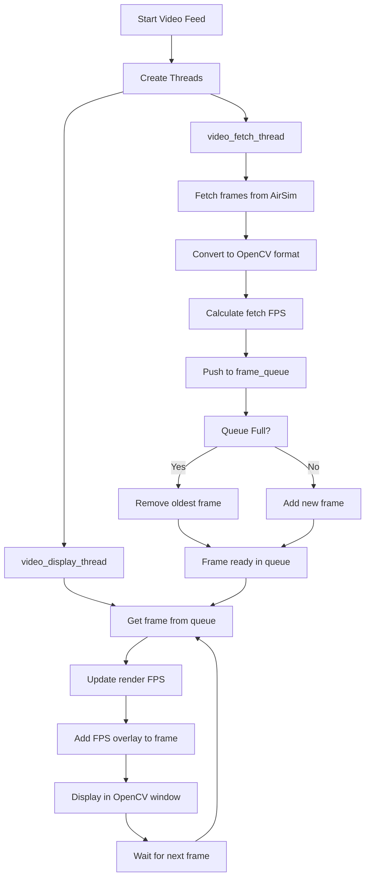

# AirSim Camera Pipeline

This document explains the camera pipeline implemented in the `airsim_offboard_control.py` script, which handles real-time video feed from AirSim simulation.

## Overview

The camera pipeline uses a producer-consumer model with multi-threading to fetch frames from AirSim and display them in real-time. It includes FPS tracking and frame queuing to maintain smooth video playback.

## Pipeline Architecture

## Detailed Flow

1. **Producer Thread (`video_fetch_loop`)**:
   - Fetches frames from AirSim using `airsim_client.simGetImages()`
   - Converts raw image data to OpenCV format (BGR)
   - Calculates and smooths fetch FPS
   - Pushes frames to a thread-safe queue

2. **Consumer Thread (`video_display_loop`)**:
   - Retrieves frames from the queue
   - Calculates and smooths render FPS
   - Adds FPS overlay to the frame
   - Displays the frame in an OpenCV window
   - Handles window refresh

3. **Frame Management**:
   - Uses a bounded queue to limit memory usage
   - Implements frame dropping when queue is full
   - Maintains most recent frames for smooth playback

## Key Features

- **Thread Safety**: Uses Python's `queue.Queue` for thread-safe frame passing
- **Performance Monitoring**: Tracks both fetch and render FPS
- **Memory Management**: Bounded queue prevents memory overflow
- **Real-time Display**: Smooth frame rendering with FPS overlay
- **Error Handling**: Graceful degradation if AirSim connection fails