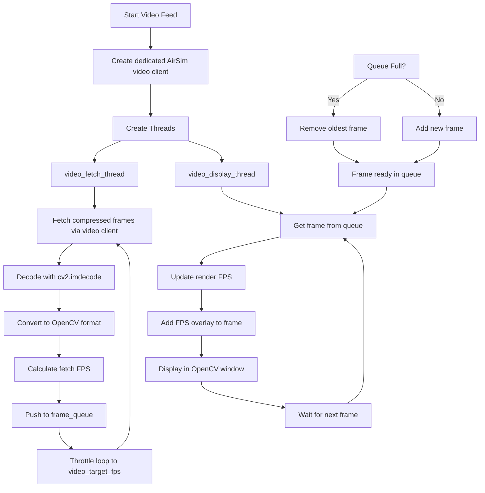

# AirSim Camera Pipeline

This document explains the camera pipeline implemented in the `airsim_offboard_control.py` script, which handles real-time video feed from AirSim simulation.

## Overview

The camera pipeline uses a producer-consumer model with multi-threading to fetch frames from AirSim and display them in real-time. It includes FPS tracking and frame queuing to maintain smooth video playback.

The pipeline runs on a **dedicated AirSim client** (its own `MultirotorClient` RPC session) that is separate from the main control client, so video RPC calls never contend with the flight-control connection. Frames are requested **compressed** (JPEG/PNG), decoded with `cv2.imdecode`, and the fetch loop is **rate-limited** to `video_target_fps` to keep bandwidth, CPU, and GIL pressure low.

## Pipeline Architecture

## Detailed Flow

1. **Producer Thread (`video_fetch_loop`)**:
   - Uses the dedicated `video_client` (a separate `MultirotorClient` session) so its RPC loop is never shared with the control client
   - Fetches frames from AirSim using `video_client.simGetImages()` with `compress=True`
   - Decodes the compressed bytes into a BGR image via `cv2.imdecode`
   - Calculates and smooths fetch FPS
   - Pushes frames to a thread-safe queue
   - Throttles itself to `video_target_fps` so the loop stops only as fast as needed

2. **Consumer Thread (`video_display_loop`)**:
   - Retrieves frames from the queue
   - Calculates and smooths render FPS
   - Adds FPS overlay to the frame
   - Displays the frame in an OpenCV window
   - Handles window refresh

3. **Frame Management**:
   - Uses a bounded queue to limit memory usage
   - Implements frame dropping when queue is full
   - Maintains most recent frames for smooth playback

## Key Features

- **Isolated RPC Session**: Video uses its own AirSim client, avoiding thread-unsafe sharing of the main control client's msgpackrpc session
- **Compressed Transfer**: Frames requested with `compress=True`, cutting per-frame payload from ~1.2 MB (raw 848x480 RGB) to tens of KB
- **Rate Limiting**: Fetch loop paced to `video_target_fps` to bound bandwidth, CPU, and GIL contention
- **Thread Safety**: Uses Python's `queue.Queue` for thread-safe frame passing
- **Performance Monitoring**: Tracks both fetch and render FPS
- **Memory Management**: Bounded queue prevents memory overflow
- **Real-time Display**: Smooth frame rendering with FPS overlay
- **Error Handling**: Graceful degradation if AirSim connection fails